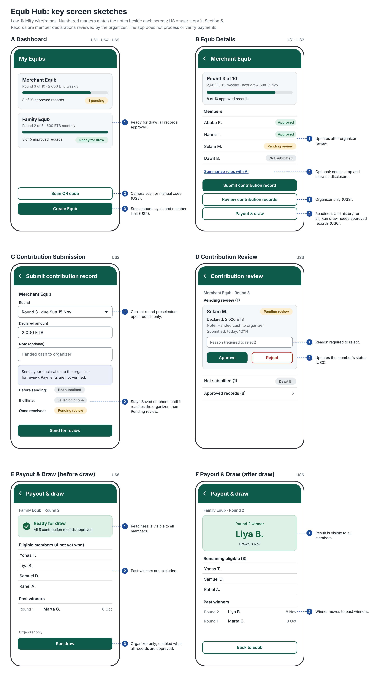

# Project Proposal: Equb Hub

## 1. Title and one-sentence description

**Working Title:** Equb Hub

An app that helps traditional rotating savings (Equb) organizers and members to record contributions, track schedules, and coordinate payout turns transparently so that groups avoid bookkeeping disputes, manual phone follow-ups, and missed meeting draws.

Equb Hub is an educational coordination and record-management tool. It tracks member-declared contribution records, organizer reviews, and draw transparency without collecting, holding, or transferring real financial funds.

## 2. Group

| Name | Role |
|---|---|
| Yonatan Azmir | Team lead: coordinates the work, keeps the repository organized and checks that the parts fit together |
| Shalom Arbsie | Data and backend: builds the server service, user accounts, online database and offline storage |
| Nebiyu Amare | Screens and design: builds the app screens and navigation |
| Yanet Geleta | Main features and testing: builds contribution and payout features, the camera feature and the AI summary, and writes tests |

## 3. The problem

A traditional Equb is a rotating savings system widely used across Ethiopia where members contribute an agreed amount at regular intervals and one eligible member receives the pooled collection each round. While culturally vital, coordinating an Equb through paper notebooks, physical meetings, and scattered phone or SMS messages creates severe friction on both sides of the group.

We spoke with **Agernesh Gela**, who organizes a traditional neighborhood Equb. She highlighted three persistent operational challenges:
1. **Hard to verify payments:** She cannot easily confirm when a member says they have paid, especially when transfer notifications and payments arrive through different channels (Telebirr, bank apps, cash) at different times without clear sender names attached.
2. **Fragile paper records:** Paper notebooks frequently contain errors or can be disputed, particularly when multiple members arrive at once to pay and the organizer is rushed.
3. **Turn bias and suspicion:** Members often suspect bias in who receives the first turn, with everyone lobbying to go first and questioning the fairness of manual paper draws.

From the member side, **Getachew Azmir**, an experienced Equb participant, explained that staying informed is equally frustrating. After transferring money, he has no shared receipt or confirmation that the payment was recorded. Missing a physical meeting leaves him dependent on second-hand phone calls, and finding new trustworthy groups to join is rigid and slow due to in-person paperwork.

**Equb Hub** resolves these problems for both organizers and members. It provides a structured digital review queue so organizers like Agernesh can review member-declared contributions without paper ledger errors, and an automated, verifiable random draw that provides transparent records and reduces disputes over turns. For members like Getachew, it offers a real-time dashboard to confirm their payment status, inspect the roster, and view draw results from anywhere.

## 4. Users

* **Equb Organizer (e.g., Agernesh Gela):** The coordinator managing group rules and turns.
  * *Needs:* A clear queue to verify and approve member contribution claims, eliminate paper notebook errors, and execute an unbiased, verifiable draw.
  * *Usage frequency:* 2–3 times a week during collection periods, and on draw days.

* **Equb Member (e.g., Getachew Azmir):** A regular contributor in the rotation.
  * *Needs:* Submitting contribution declarations, receiving confirmation of approval, seeing upcoming deadlines, and checking draw results without attending every physical meeting.
  * *Usage frequency:* 1–2 times per collection round, plus occasional status checks.

* **Prospective Member:** A person invited to join an existing group.
  * *Needs:* Scanning a QR invitation to review contribution rules and join without manual paperwork.
  * *Usage frequency:* Once or twice during onboarding.

## 5. User stories

1. As a member, I want to view my Equb's rules, contribution schedule, and member payment statuses so that I always have a clear, transparent view of group progress. (**must**)
2. As a member, I want to submit a contribution declaration for an active round so that the organizer can review and confirm my payment. (**must**)
3. As an organizer, I want to approve or reject submitted contribution records so that the group ledger remains accurate and verified. (**must**)
4. As an organizer, I want to create an Equb group with defined contribution amounts and cycle rules so that members have clear terms from the start. (**should**)
5. As a prospective member, I want to scan a group QR code invitation using my phone's camera so that I can join a group without inflexible paperwork. (**should**)
6. As a member, I want to view the random payout draw results among eligible members so that the recipient selection is transparent and fair. (**should**)
7. As a member, I want an AI assistant to summarize Equb rules and deadlines so that I can quickly understand group terms. (**could**)
8. As an organizer, I want to export an offline cycle summary so that the group has a downloadable backup of completed rounds. (**could**)

## 6. Screens

| Screen | Purpose | User stories |
|---|---|---|
| **Sign In / Register** | Authenticates users via Firebase Auth and sets up basic profile details. | General |
| **Dashboard** | Displays all Equbs the user belongs to, current round numbers, and quick status badges. | US1 |
| **Equb Details** | Shows group rules, contribution schedule, full member roster with live payment approval statuses, and contextual AI summary. | US1, US7 |
| **Contribution Submission** | Allows a member to select the active round, declare their payment with an optional reference note, and submit for organizer review. | US2 |
| **Contribution Review** | Gives organizers a clean queue to inspect pending member submissions, view reference notes, and approve or reject records. | US3 |
| **Create Equb** | Allows an organizer to set group title, contribution amount, cycle frequency (weekly/monthly), and member cap. | US4 |
| **QR Scanner & Join** | Uses the camera to scan an organizer’s invite QR code (or enter code manually) to request membership. | US5 |
| **Payout & Draw** | Displays round collection readiness, eligible member pool, the verifiable random draw result, and past winner history. | US6 |


### Key screen sketches



## 7. Data model

The core domain entities and their fields are defined as immutable models (`freezed` in Dart):

```
User: id, fullName, email, phone, createdAt
EqubGroup: id, title, description, contributionAmount, frequency, memberLimit, organizerId, createdAt
Membership: id, equbId, userId, role, status, joinedAt
CyclePeriod: id, equbId, periodNumber, deadline, status, winnerMemberId
ContributionRecord: id, cyclePeriodId, memberId, declaredAmount, note, status, reviewerId, reviewedAt, rejectionReason
PayoutDraw: id, cyclePeriodId, eligibleMemberIds, selectedWinnerMemberId, drawnAt
Invitation: id, equbId, inviteCode, qrPayload, expiresAt
```

* An **EqubGroup** has one organizer (**User**) and multiple **Memberships**.
* In each **CyclePeriod**, each active **Membership** can have at most one **ContributionRecord** (status: *pending*, *approved*, or *rejected*); duplicate submissions for the same period are prevented.
* A **PayoutDraw** can only occur when all active members in that **CyclePeriod** have an *approved* **ContributionRecord**.
* A member who has already won in the active rotation cycle is excluded from subsequent draws until the full cycle completes and turns reset.

## 8. Data sources

Equb Hub uses three distinct data sources as required by the course architecture, each behind an abstract repository interface:

1. **Local persistence (`drift` & `shared_preferences`):**
   * **Drift (SQLite):** Caches Equb group summaries, member rosters, and recent draw history for fast offline viewing. Also stores offline draft contribution records.
   * **`shared_preferences`:** Stores basic user preferences (theme mode, onboarded flag, last selected Equb ID).
2. **REST web service (Shelf project backend):**
   * Authoritative endpoints for operations that require strict server-side validation: evaluating payout readiness (`GET /equbs/{id}/readiness`), executing the verifiable random draw (`POST /equbs/{id}/draw`), and generating downloadable cycle summaries (`GET /equbs/{id}/export-summary`).
3. **Firebase (Authentication & Cloud Firestore):**
   * **Firebase Auth:** Handles user registration, email/password login, and security tokens.
   * **Cloud Firestore:** Real-time database for collaborative collections (`users`, `equb_groups`, `memberships`, `cycle_periods`, `contribution_records`, `invitations`). Live snapshots ensure member status badges update immediately when an organizer approves a payment.

## 9. Device feature and AI feature

* **Device feature — Camera QR scanner (serves US5):**
  * *Permission:* Requests `android.permission.CAMERA`.
  * *Handling:* If granted, scans the QR code. If denied, shows an explanatory message with an immediate option to type the 6-character code manually. If permanently denied, guides the user to settings. If unavailable, falls back cleanly to manual code entry.
  * *Design:* Placed behind a `QrScannerService` interface with a `FakeQrScannerService` for automated tests.
* **AI feature — Rules & schedule assistant (serves US7):**
  * *Data sent & recipient:* Sends only non-sensitive group parameters (rules text, contribution amount, cycle frequency, deadlines) to the Google Gemini API via the project's backend proxy service to prevent exposing API keys in the client app. Never sends member names, phone numbers, or contribution notes.
  * *Consent & disclosure:* Clearly displayed disclosure banner; requests trigger only when the user explicitly taps "Summarize with AI".
  * *Failures:* Falls back to local cached rules from Drift if offline or timed out. AI responses are strictly informational and have no authority to approve payments or trigger draws.
  * *Design:* Placed behind an `AiSummaryService` interface with a `FakeAiSummaryService` for testing.

## 10. Risks

| Risk | Likelihood | Plan |
|---|---|---|
| **Unauthorized access or tampering with records** | Medium | Enforce role-based access via Firestore security rules and backend authorization; only organizers can update review decisions. |
| **Network delay or temporary disconnection** | Medium | Cache read data with Drift; show loading/offline states; require server confirmation before marking a record approved. |
| **Camera permission refused or camera broken** | Low | Provide an instant text field to type or paste the 6-character group invite code manually. |
| **User assumes app handles real money** | Medium | Display clear notices stating the app is a record coordinator and does not process real money; use fake/simulated demo data. |

## 11. Milestone plan

* **Milestone 1 (Week 6 — Tag `m1`): Screens, Navigation & In-Memory State**
  * *Stories completed:* **US1** (view group status), **US2** (submit declaration), **US3** (organizer review), and **US4** (create group).
  * *Deliverables:* Feature-first folder structure; all screens navigable via `go_router`; Riverpod providers with `freezed` models; in-memory repositories behind interfaces; initial unit and widget tests; clean `flutter analyze`.
* **Milestone 2 (Week 10 — Tag `m2`): Real Data, Backends & Tests**
  * *Stories completed:* **US1, US2, US3, US4** wired to live data; **US6** (payout draw logic and history).
  * *Deliverables:* Local persistence via Drift; Firebase Authentication and Cloud Firestore for live records; REST backend endpoints for draw verification; loading, error, and empty states on all data screens; repository tests with fakes.
* **Final Submission (Week 14 — Tag `final`): Features, Quality & Release**
  * *Stories completed:* **US5** (Camera QR scanner device feature), **US7** (AI rules assistant), and **US8** (offline cycle export).
  * *Deliverables:* Full test suite reaching ≥ 60% line coverage; `development` and `production` build flavors; signed production APK; complete documentation (`README.md`, `AI_USAGE.md`, `DECISIONS.md`, `PRIVACY.md`, `USER_TEST.md`).

## 12. AI-use plan

The team will design, code, and test the application primarily by hand; AI assistants are used strictly in a secondary, supporting capacity.

* **Tools planned:** GitHub Copilot, ChatGPT, Google Antigravity / Gemini, and Claude.
* **Intended uses:** Explaining unfamiliar Flutter/Riverpod APIs, generating boilerplate model code and initial test cases, and proofreading documentation.
* **Boundaries & Integrity:**
  * The architecture, core domain models, business logic (e.g., payout eligibility rules), and security rules are authored by team members first without AI.
  * Every generated snippet is reviewed line-by-line, verified against official documentation, and validated with tests.
  * No API keys, credentials, or personal data will ever be entered into AI prompts.
  * Every member understands all committed code and will be prepared to explain, trace, and modify it during the instructor's oral examinations.
  * All substantial AI contributions will be logged in `AI_USAGE.md` as required by course policy.
